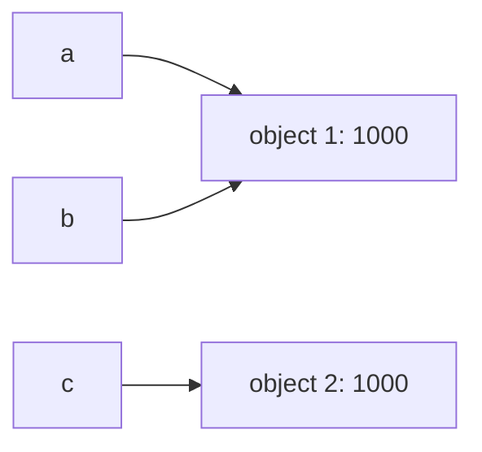

# Лабораторная работа №1
### По дисциплине: Основы программирования
### Выпонила Шкурай Ульяна Андреевна
### Тема: Выполнение программы, объекты и базовые типы Python

---
### Цель работы:
Разобраться, как CPython выполняет программу, научиться отличать имя от объекта, корректно применять операции сравнения и работать с базовыми типами данных Python. 

---
### Ход работы
### Задание 1. От исходного кода к байткоду
#### Часть 1. Режимы запуска
При выполнении программы в интерактивном интерпретаторе на терминал выводится результат арифметического выражения:

    2+3*4
    14
Однако, записав то же выражение в файл с разрешением “.py” и запустив его, вывод будет пустой(рис. 2). Так происходит потому что в отличие от интерактивной консоли, запрограммированной под работу с программистом, система запуска файла не подразумевает исполнения действий без запроса. Чтобы программа вывела результат, нужно явно использовать функцию “print()”.

Код:

    print(2+3*4)

Вывод:

    14

#### Часть 2. Выражения и инструкции

Рассмотрим строки нового отрывка кода:

    course = "Python"
    hours = 4 * 2
    print(f"{course}: {hours} часов")

Выражениями являются арифметические выражения без присваивания их значения переменным ```4 * 2```, а также строковые выражения ```“{course}: {hours} часов”```.

Инструкциями являются операции присваивания ```course = “Python”, hours = 4 * 2``` и вызов функции ```print(f”{course}: {hours} часов”)```.

Литералы – конкретные значения без операций, производимых над ними. В данном коде – переменные ```course``` , ```hours``` , числа ```4``` , ```2``` , строка ```“Python”``` .

Также в данном отрывке создаются имена для переменных – ```cours``` и ```hours``` .

#### Часть 3. AST и байткод

Вывод версии интерпретатора Python командой ```python - -version``` :

    Python 3.10.9 (tags/v3.10.9:1dd9be6, Dec  6 2022, 20:01:21) [MSC v.1934 64 bit (AMD64)] on win32

Структура кода в файле ```task_1.py``` , запрошенная командой ```python -m ast task_1.py``` :

    Module(
    body=[
        Expr(
            value=BinOp(
                left=Constant(value=2),
                op=Add(),
                right=BinOp(
                left=Constant(value=3),
                op=Mult(),
                right=Constant(value=4)))),
        Expr(
            value=Constant(value='Компьютер посчитал значение выражения, но не получил \n   команды вывести результат на экран, поэтому вывод пустой')),
        Expr(
            value=Call(
                func=Name(id='print', ctx=Load()),
                args=[
                BinOp(
                    left=Constant(value=2),
                    op=Add(),
                    right=BinOp(
                        left=Constant(value=3),
                        op=Mult(),
                        right=Constant(value=4)))],
                keywords=[])),
        Expr(
            value=Constant(value='программа выводит результат запуска')),
        Assign(
            targets=[
                Name(id='course', ctx=Store())],
            value=Constant(value='Python')),
        Assign(
            targets=[
                Name(id='hours', ctx=Store())],
            value=BinOp(
                left=Constant(value=4),
                op=Mult(),
                right=Constant(value=2))),
        Expr(
            value=Call(
                func=Name(id='print', ctx=Load()),
                args=[
                JoinedStr(
                    values=[
                        FormattedValue(
                            value=Name(id='course', ctx=Load()),
                            conversion=-1),
                        Constant(value=': '),
                        FormattedValue(
                            value=Name(id='hours', ctx=Load()),
                            conversion=-1),
                        Constant(value=' часов')])],
                keywords=[]))],
    type_ignores=[])

Узлы AST, соответствующие присваиванию значений переменным course и hours:

        Assign(
            targets=[
                Name(id='course', ctx=Store())],
            value=Constant(value='Python')),
        Assign(
            targets=[
                Name(id='hours', ctx=Store())],
            value=BinOp(
                left=Constant(value=4),
                op=Mult(),
                right=Constant(value=2)))

Узлы AST, соответствующие выполнению арифметической операции:

        Expr(
            value=BinOp(
                left=Constant(value=2),
                op=Add(),
                right=BinOp(
                left=Constant(value=3),
                op=Mult(),
                right=Constant(value=4))))

Узлы AST, соответствующие вызову print():

        Expr(
                    value=Call(
                        func=Name(id='print', ctx=Load()),
                        args=[
                        JoinedStr(
                            values=[
                                FormattedValue(
                                    value=Name(id='course', ctx=Load()),
                                    conversion=-1),
                                Constant(value=': '),
                                FormattedValue(
                                    value=Name(id='hours', ctx=Load()),
                                    conversion=-1),
                                Constant(value=' часов')])],
                        keywords=[]))

Ознакомимся с AST через команду ```python -m dis task_1.py```. Вывод:

    1           0 NOP

    2           2 NOP

    5           4 LOAD_NAME                0 (print)
                6 LOAD_CONST               0 (14)
                8 CALL_FUNCTION            1
                10 POP_TOP

    6          12 NOP

    9          14 LOAD_CONST               1 ('Python')
                16 STORE_NAME               1 (course)

    10          18 LOAD_CONST               2 (8)
                20 STORE_NAME               2 (hours)

    11          22 LOAD_NAME                0 (print)
                24 LOAD_NAME                1 (course)
                26 FORMAT_VALUE             0
                28 LOAD_CONST               3 (': ')
                30 LOAD_NAME                2 (hours)
                32 FORMAT_VALUE             0
                34 LOAD_CONST               4 (' часов')
                36 BUILD_STRING             4
                38 CALL_FUNCTION            1
                40 POP_TOP
                42 LOAD_CONST               5 (None)
                44 RETURN_VALUE

В дизассемблированном коде за загрузку константы отвечают следующие инструкции:

```  9          14 LOAD_CONST               1 ('Python')```

``` 10          18 LOAD_CONST               2 (8)```

за вызов функции отвечают инструкции:

```11          22 LOAD_NAME                0 (print)```

#### Контрольный вопрос: 
+ Почему байткод CPython нельзя считать машинным кодом процессора?

Машинный код выполняется непосредственно физическим процессором, а байткод CPython выполняется виртуальной машиной и не передает команды компьютеру напрямую. Поэтому байткод CPython нельзя считать машинным кодом процессора.

### Задание 2. Имена, объекты и сравнение
Рассмотрим фрагмент кода:

    a = 1000
    b = a
    c = int("1000")

    print("Типы:", type(a), type(b), type(c))
    print("Идентификаторы:", id(a), id(b), id(c))
    print("a == b:", a == b)
    print("a is b:", a is b)
    print("a == c:", a == c)
    print("a is c:", a is c)

Прогноз: 

+ первое сравнение - истинно, потому что значения ```a``` и ```b``` совпадают

+ второе сравнение - истинно, потому что переменной ```b``` была присвоена ячейка ```a``` - это один и тот же объект в памяти компьютера(одинаковый идентификатор)
    
+ третье сравнение - истинно, потому что обе переменные содержат числа равной величины, хотя заложены в разные ячейки памяти
    
+ четвертое сравнение - ложно, потому что оператор ```is``` сравнивает не значение переменных, а их место в памяти компьютера(разные идентификаторы)

Результат, полученный после запуска кода, соответствует прогнозу.

Для каждого созданного в Python объекта выделяется некоторое количество памяти. Объекты, созданные независимо друг от друга, помещаются в разные ячейки и имеют разные адреса. Если сравнивать такие объекты, даже если их содержимое одинаково, они не будут идентичны. Так в рассматриваемом фрагменте ```a is c``` мы видим, что переменные a и c отсылаются к разным объектам. Однако их числовые значения равны, и ```a == c``` возвращает истину. 

Изобразим связь переменных и объектов схематично:




Рассмотрим фрагмент кода:

    c = None
    print('Yes' if c is None else 'No')

Выводит:

    Yes

Переменной ```c``` присваивается значение ```None``` и выполняется проверка, подтверждающая, что ```c``` обозначает объект ```None```.

Рассмотрим фрагмент кода:

    first = "python"
    second = "py" + "thon"

    print(first == second)
    print(first is second)
    print(id(first))

Выводит:

    True
    True

Как мы видим, логика сравнения строковых переменных отличается.
Оптимизация интерпретатора Python при присваивании переменной строкового значения проверяет, существует ли такая строка в памяти, и если да, присваивает переменной то же значение, поэтому ```first``` и ```second``` оказываются идентичны.


Сформулируем правило. 

Когда требуется проверить равенство значений переменных, следует использовать ```==``` . В ином случае, когда необходимо проверить, на один ли объект ссылаются переменные, следует использовать ```is``` .

#### Контрольные вопросы:

+ Создает ли инструкция ```a = b``` копию объекта?

Нет, не создает, а только прикрепляет переменную a к ячейке памяти, к которой отсылается переменная b.

+ Что возвращают ```type()``` и ```id()```?

Функция ```type()``` возвращает класс объекта, а ```id()``` – адрес аргумента в памяти.

+ Почему ```None``` принято сравнивать с помощью ```is```, а числа и строки с помощью ```==```?

Проверка с помощью “is” не будет искать значения для объекта “None”, в отличие от “==”, и вернет результат гораздо быстрее.

### Задание 3. Числовые типы, операции и преобразования

#### Эксперимент A. ```int``` и арифметические операторы

Исходный код:

    def f(n):
        print(n, type(n))

    x = 17
    y = 5

    f(x + y)
    f(x - y)
    f(x * y)
    f(x / y)
    f(x // y)
    f(x % y)
    f(x ** y)

Выводит:

    22 <class 'int'>
    12 <class 'int'>
    85 <class 'int'>
    3.4 <class 'float'>
    3 <class 'int'>
    2 <class 'int'>
    1419857 <class 'int'>

Результаты при использовании ```/``` и ```//``` отличаются. Оператор деления возвращает вещественное число ```float``` , не теряя дробную часть. Оператор целочисленного деления округляет результат вниз, игнорируя дробную часть, и возвращает целое число```int``` . В примере с числами ```17``` и ```5``` мы можем видеть это наглядно.

#### Эксперимент B. Большие целые числа

Код:

    a = 2 ** 1000
    print(a)

Выводит:

    10715086071862673209484250490600018105614048117055336074437503883703510511249361224931983788156958581275946729175531468251871452856923140435984577574698574803934567774824230985421074605062371141877954182153046474983581941267398767559165543946077062914571196477686542167660429831652624386837205668069376

Как мы видим, проблемы с выводом числа ```2 ** 1000``` не возникает. Особенность целых чисел Python в том, что они не имеют фиксированного размера. В других языках программирования важно указать правильный тип, который зависит от того, насколько число большое. Когда число слишком велико для указанного типа, программа не может с ним работать. В Python количество памяти, которое можно выделить под число, ограничено только оперативной памятью компьютера.

#### Эксперимент C. ```float```

Код:

    import math
    result = 0.1 + 0.2
    print(result)
    print(result == 0.3)
    print(result - 0.3)
    print(math.isclose(result, 0.3))

Выводит:

    0.30000000000000004
    False
    5.551115123125783e-17
    True

Как мы видим, результат сложения, полученный программой в строке ```print(result)``` , отличается от математически правильного. Проблема в том, что дроби ```0.1``` и ```0.2``` не имеют конечного двоичного представления, и в памяти фиксируются приблизительные значения.

Для безопасного сравнения чисел с плавающей точкой следует использовать функцию ```isclose()``` из модуля ```math``` .

#### Эксперимент D. ```bool```, ```complex``` и явное преобразование типов

Код:

    def f(n):
        print(n, type(n))

    f(int("42"))
    f(float("3.14"))
    f(str(2026))
    f(bool(0))
    f(bool(-1))
    f(bool(""))
    f(bool("False"))
    a = complex(2, -3)
    f(a)
    print(a.real)
    print(a.imag)
    print(type(False))

Выводит:

    42 <class 'int'>
    3.14 <class 'float'>
    2026 <class 'str'>
    False <class 'bool'>
    True <class 'bool'>
    False <class 'bool'>
    True <class 'bool'>
    (2-3j) <class 'complex'>
    2.0
    -3.0
    <class 'bool'>

```bool(“False”)``` возвращает истину, потому что в данном примере ```“False”``` – это строка, а класс ```bool``` считает истиной все непустые и ненулевые значения.

#### Контрольные вопросы:

+ Почему результат обычного деления двух объектов ```int``` имеет результат ```float```?

Обычный оператор деления выводит результат с учетом дробной части, поэтому деление целых чисел представляется вещественным числом.

+ В чем отличие преобразования ```int(“42”)``` от ```int(42.9)```?

Первое преобразование – перевод строки в целое число, второе – перевод вещественного числа в целое.

+ Какие значения из эксперимента D являются ```falsy```?

```bool(0)``` и ```bool(“”)``` являются ```falsy```.

### Задание 4. Строки, Unicode и форматирование

На основе исходных данных и задания был создан код:

    student = "Анна Смирнова"
    course = "Основы программирования на Python"
    completed = 7
    total = 10

    print(student[0], student[3], sep=',')

    name = student[:-9]
    last_name = student[5:]
    print(name, last_name, sep=',')

    print(student.upper(), student.lower(), sep=',')

    inicials = student[0]+'.'+student[5]+'.'
    print(inicials)

    print(course[::-1])

    result1 = "%s — %s: %d/%d (%.1f%%)" % (name, course, completed, total, (completed/total)*100)
    print(result1)

    result2 = "{} — {}: {}/{} ({:.1f}%)".format(name, course, completed, total, (completed/total)*100)
    print(result2)

    result3 = f"{name} — {course}: {completed}/{total} ({(completed/total)*100:.1f}%)"

    symbol = "Я"
    print(symbol)
    print(ord(symbol))
    print(chr(ord(symbol))) 
    print(symbol.encode('utf-8'))
    print(len(symbol.encode('utf-8')))

Вывод:

    А,а
    Анна,Смирнова
    АННА СМИРНОВА,анна смирнова
    А.С.
    nohtyP ан яинавориммаргорп ывонсО
    Анна — Основы программирования на Python: 7/10 (70.0%)
    Анна — Основы программирования на Python: 7/10 (70.0%)
    Я
    1071
    Я
    b'\xd0\xaf'
    2

При попытке изменить символ строки с помощью индексации возникает ошибка.

Код:

    l='color'
    l[0]='k'

Сообщение об ошибке:

    Traceback (most recent call last):
    File "c:\Users\USER\OneDrive\Desktop\proga\Основы программирования\lab_01\task_4.py", line 35, in <module>
        l[0]='k'
        ~^^^
    TypeError: 'str' object does not support item assignment

Строки в языке Python являются неизменяемыми, поэтому изменить строку таким образом не получится – придется создать новую.

#### Контрольные вопросы:

+ Почему ```len(symbol)``` и ```len(symbol.encode(“utf-8”))``` могут различаться?

```len(symbol)``` возвращает длину строки, а ```len(symbol.encode(“utf-8”))``` – длину последовательности байтов в кодировке строки.

+ Что означают границы и шаг в записи ```text[start:stop:step]```?

Это схематичный пример работы срезов в Python. ```start``` – индекс символа, который первым будет включен в конечную строку. Символы, стоящие ранее, будут вырезаны. ```stop``` – индекс, до которого идет вырезка(символ с данным индексом не будет включен в конечную строку). ```step``` – интервал, через который мы берем символы исходной строки в конечную.

+ Почему строка считается неизменяемым объектом, хотя методы вроде ```.upper()``` возвращают измененный текст?

Методы вроде ```.upper()``` не изменяют строку, а создают новую на основе данной.

### Задание 5. Информационная карточка вычислительного эксперимента

В соответствии с инструкциями была создана консольная программа ```task_5.py``` . 

Документация с кратким описанием программы:

    Данная программа запрашивает у пользователя:
        -имя исследователя(str)
        -название эксперимента(str)
        -количество выполненных запусков(int)
        -длительность одного запуска в секундах(float)
        -действительная часть комплексного коэффициента(float)
        -мнимая часть комплексного коэффициента(float)

    Далее вычисляются:
        -общая длительность всех запусков в секундах
        -общая длительность всех запусков в минутах
        -комплексный коэффициент
        -квадрат модуля коэффициента
    Проверяется:
        -является ли число запусков ненулевым

    Программа выводит:
        -название эксперимента
        -имя исследователя
        -количество запусков
        -общая длительность всех запусков(в секундах и в минутах)
        -комплексный коэффициент
        -квадрат модуля коэффициента
        -есть ли выполненные запуски

    Для корректной работы программы требуется вводить данные в соответствии с запрашиваемым типом.
    Вводите только целочисленные значения в поле с типом int без указания дробной части. Например:
            Количество выполненных запусков: 5
    Вводите целочисленные или вещественные значения в поле с типом float. При необходимости 
    используйте в качестве разделителя запятую. Например:
            Длительность одного запуска в секундах: 5.13

    Нажатие клавиши Enter завершает ввод значения для одного запроса и активирует ввод для следующего, если таковой существует. После ввода последнего значения при нажатии клавиши Enter начинаются вычислительные процессы, на терминал выводится результат.

Анализ кода:

После выполнения инструкций переменные связываются со следующими типами объектов:

+ ```name``` – строка(```str```)

+ ```experiment``` – строка(```str```)

+ ```number``` – целое число(```int```)

+ ```only_duration``` – вещественное число(```float```)

+ ```complex_re``` – вещественное число(```float```)

+ ```complex_im``` – вещественное число(```float```)

+ ```duration_sec``` – вещественное число(```float```)

+ ```duration_min``` – вещественное число(```float```)

+ ```coefficient``` – комплексное число(```complex```)

+ ```abs_coefficient_squared``` – вещественное число(```float```)

+ ```has_runs``` – логический тип(```bool```)

Разберем следующую строку:

    abs_coefficient_squared = complex_re ** 2 + complex_im ** 2

```2``` – литерал

```abs_coefficient_squared``` , ```complex_re``` , ```complex_im``` – имена переменных

```=``` , ```**``` , ```+``` – операторы(присваивания, возведения в степень, сложения)

Строка с вызовом функции:

	coefficient = complex(complex_re, complex_im)

```coefficient``` , ```complex``` , ```complex_re``` , ```complex_im``` – имена переменных и функции

```=``` – оператор присваивания

```complex(complex_re, complex_im)``` – вызов функции

Рассмотрим путь программы.

Все начинается с исходного файла – текста программы в разрешении ```.py```. Далее Python разбирает написанный код, проверяет на наличие ошибок и читаемость для компьютера. Если код исправен, формируется дерево программы AST, структурирование команд. Затем AST переводится в байткод, понятный для Python, а на основе него виртуальной машиной уже исполняется заданная программа.

Важно заметить: введенные через ```input()``` пользователем данные изначально имеют строчный тип. Для арифметических вычислений нужно задать числовой тип явно.

#### Контрольный вопрос:

+ Что в этой программе изменится на уровне объектов и связывания имен после повторного присваивания нового значения уже существующему имени?

	Когда уже существующей переменной присваивается новое значение, ее связь с предыдущим разрывается. Если на отвязанный объект не ссылаются, он удаляется.

---

## Вывод 

В ходе выполнения лабораторной работы я разобралась с путем выполнения программы Python от исходного текста до выполнения байткода виртуальной машиной, научилась работать с переменными, разными типами данных, операторами сравнения, поняла причину погрешности вычислений с числами с плавающей точкой и в целом ознакомилась с основами языка программирования Python.