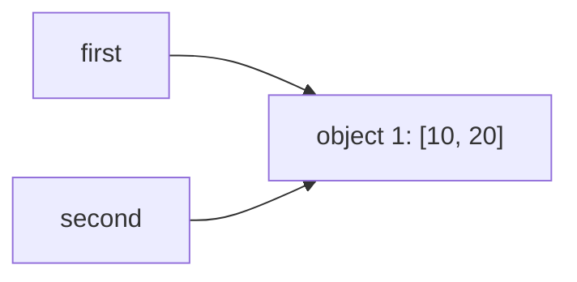
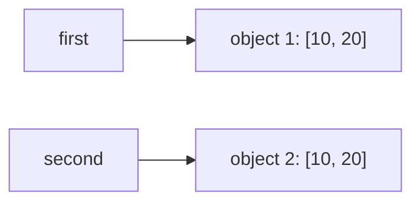
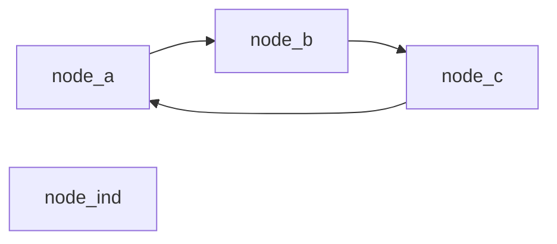

# Лабораторная работа №2
### По дисциплине: Основы программирования
### Выпонила Шкурай Ульяна Андреевна
### Тема: Выполнение программы, объекты и базовые типы Python

---
### Цель работы:
Исследовать связь между именами и объектами, понять различия между присваиванием, поверхностным и глубоким копированием, а также познакомиться с механизмами управления памятью в CPython.

---
### Ход работы
### Задание 1. От исходного кода к байткоду
#### Эксперимент A. Неизменяемый объект

- Ожидаемый результат: До переписывания переменной a идентификаторы будут одинаковы, после – различны, при этом b не изменится.


Листинг кода:

```python
a = 10
b = a

print(a, b)
print(id(a), id(b))

a += 1

print(a, b)
print(id(a), id(b))
``` 

Выводит:

```
10 10
140710638126280 140710638126280
11 10
140710638126312 140710638126280
```

Как мы видим, после операции `a += 1` значение, связанное с именем `b`, не изменилось. При изменении переменной `a` , если к ее объекту привязана еще одна переменная, `a` от него открепляется, и на основе прежнего объекта создается новый. Убедиться в этом можно, сопоставив выведенные идентификаторы. Прогноз оказался верным.

#### Эксперимент B. Изменяемый объект

- Ожидаемый результат: Операция присваивания second = first не создаст новый объект, и изменения одного списка отразятся на другом, а при копировании будет создан независимый объект.

Запуск исходного кода показал, что при изменении одного списка меняется и второй.

Листинг исходного кода:
```python
first = [10, 20]
second = first

print(first, second)
print(id(first), id(second))

second.append(30)

print(first, second)
print(id(first), id(second))
```

Выводит:

```
[10, 20] [10, 20]
1913070379136 1913070379136
[10, 20, 30] [10, 20, 30]
1913070379136 1913070379136
```

Переадресации, как Эксперименте A, не происходит, потому что списки являются изменяемыми объектами в языке Python. 

Используем метод copy()для создания независимых списков в дополненной версии кода. 

Листинг дополненного кода::

```python
first = [10, 20]
second = first
second = first.copy()

print(first, second)
print(id(first), id(second))

print(first == second)
print(first is second)

second.append(30)

print(first, second)
print(id(first), id(second))
```

Выводит:

```
True
False
[10, 20] [10, 20]
2060968550528 2060968699072
[10, 20] [10, 20, 30]
2060968550528 2060968699072
```

Как мы видим, после копирования переменные ссылаются на разные объекты, и изменение одного списка не затрагивает другой. Прогноз оказался верным.

До переназначения связь между списком и переменными выглядела так:


Связь между списками и переменными после переназначения:



Важно заметить: поверхностное копирование методом `.copy()` допустимо только для неизменяемых типов данных. Изменения во вложенных данных при поверхностном копировании отразится как на исходном, так и на скопированном объекте. Далее мы в этом убедимся.

#### Практическая задача
В первой версии кода вторая конфигурация задается присваиванием. При добавлении новой характеристики и изменении вложенных списков в `config2` `config1` также меняется.

Листинг первой версии кода:

```python
print('Первая версия:')
config1 = {
    'name' : 'Учебный проект',
    'members' : ['Иван Поддубный','Владимир Джанибеков'],
    'parameters' : [10 , 15]
                }

config2 = config1

print('До преобразования:')
print('config1:' , config1)
print('config2:' , config2)
print('identity:' , config1 is config2)

config2['members'].append('Сергей Бондарчук')
config2['parameters'].append(25)
config2['status'] = 'verified'

print('После преобразования:')
print('config1:' , config1)
print('config2:' , config2)
print('identity:' , config1 is config2)
```

Выводит:

```
Первая версия:
До преобразования:
config1: {'name': 'Учебный проект', 'members': ['Иван Поддубный', 'Владимир Джанибеков'], 'parameters': [10, 15]}
config2: {'name': 'Учебный проект', 'members': ['Иван Поддубный', 'Владимир Джанибеков'], 'parameters': [10, 15]}
identity: True
После преобразования:
config1: {'name': 'Учебный проект', 'members': ['Иван Поддубный', 'Владимир Джанибеков', 'Сергей Бондарчук'], 'parameters': [10, 15, 25], 'status': 'verified'}
config2: {'name': 'Учебный проект', 'members': ['Иван Поддубный', 'Владимир Джанибеков', 'Сергей Бондарчук'], 'parameters': [10, 15, 25], 'status': 'verified'}
identity: True
```

Так происходит, потому что словари и списки в Python являются изменяемыми, и при перезаписи для одной из переменной не создается новый объект, как и в Эксперименте B.

Во второй версии вторая конфигурация задается с помощью `copy()`. При добавлении новой характеристики в `config2` в `config1` это изменение не отображается, однако изменение вложенных списков в `config2` также изменяет соответствующие списки в `config1`.

Листинг второй версии кода:

```python
print('Вторая версия:')
config1 = {
    'name' : 'Учебный проект',
    'members' : ['Иван Поддубный','Владимир Джанибеков'],
    'parameters' : [10 , 15]
                }

config2 = config1.copy()

print('До преобразования:')
print('config1:' , config1)
print('config2:' , config2)
print('identity:' , config1 is config2)

print('Общие объекты:')
if config1['name'] is config2['name']: print('name: ',config2['name'],sep='')
if config1['members'] is config2['members']: print('members: ',config2['members'],sep='')
if config1['parameters'] is config2['parameters']: print('parameters: ',config2['parameters'],sep='')

config2['members'].append('Сергей Бондарчук')
config2['parameters'].append(25)
config2['status'] = 'verified'

print('После преобразования:')
print('config1:' , config1)
print('config2:' , config2)
print('identity:' , config1 is config2)
assert config1 is not config2, 'конфигурации связаны'
```

Выводит:

```
Вторая версия:
До преобразования:
config1: {'name': 'Учебный проект', 'members': ['Иван Поддубный', 'Владимир Джанибеков'], 'parameters': [10, 15]}
config2: {'name': 'Учебный проект', 'members': ['Иван Поддубный', 'Владимир Джанибеков'], 'parameters': [10, 15]}
identity: False
Общие объекты:
name: Учебный проект
members: ['Иван Поддубный', 'Владимир Джанибеков']
parameters: [10, 15]
После преобразования:
config1: {'name': 'Учебный проект', 'members': ['Иван Поддубный', 'Владимир Джанибеков', 'Сергей Бондарчук'], 'parameters': [10, 15, 25]}
config2: {'name': 'Учебный проект', 'members': ['Иван Поддубный', 'Владимир Джанибеков', 'Сергей Бондарчук'], 'parameters': [10, 15, 25], 'status': 'verified'}
identity: False
```

Конфигурации являются независимыми – это условие проверено методом `assert` –, но их ячейки все еще привязаны к одним и тем же объектам.

Чтобы никакие изменения в `config2` не отображались на объектах `config1`(в том числе изменение вложенных списков), используем `deepcopy()` из библиотеки `copy`. Глубокое копирование решает проблему зависимости вложенных объектов, создавая новые для каждой из конфигураций. Таким образом, никакие изменения в `config2` не отображаются на `config1`.

Листинг второй версии кода с правками:

```python
from copy import deepcopy
print('Вторая версия:')
config1 = {
    'name' : 'Учебный проект',
    'members' : ['Иван Поддубный','Владимир Джанибеков'],
    'parameters' : [10 , 15]
                }

config2 = deepcopy(config1)

print('До преобразования:')
print('config1:' , config1)
print('config2:' , config2)
print('identity:' , config1 is config2)

print('Общие объекты:')
if config1['name'] is config2['name']: print('name: ',config2['name'],sep='')
if config1['members'] is config2['members']: print('members: ',config2['members'],sep='')
if config1['parameters'] is config2['parameters']: print('parameters: ',config2['parameters'],sep='')

config2['members'].append('Сергей Бондарчук')
config2['parameters'].append(25)
config2['status'] = 'verified'

print('После преобразования:')
print('config1:' , config1)
print('config2:' , config2)
print('identity:' , config1 is config2)
assert config1 is not config2, 'конфигурации связаны'
```

Выводит:

```
Вторая версия:
До преобразования:
config1: {'name': 'Учебный проект', 'members': ['Иван Поддубный', 'Владимир Джанибеков'], 'parameters': [10, 15]}
config2: {'name': 'Учебный проект', 'members': ['Иван Поддубный', 'Владимир Джанибеков'], 'parameters': [10, 15]}
identity: False
Общие объекты:
name: Учебный проект
После преобразования:
config1: {'name': 'Учебный проект', 'members': ['Иван Поддубный', 'Владимир Джанибеков'], 'parameters': [10, 15]}
config2: {'name': 'Учебный проект', 'members': ['Иван Поддубный', 'Владимир Джанибеков', 'Сергей Бондарчук'], 'parameters': [10, 15, 25], 'status': 'verified'}
identity: False
```

#### Вопросы для анализа

1. Меняет ли `second = first` сам объект?

Нет, объект остается неизменным и не копируется, переменные `first` и `second` ссылаются на одни и те же ячейки памяти.

2. Почему операция над неизменяемым объектом приводит к связыванию имени с другим объектом?

Неизменяемые объекты по определению не могут быть модифицированы, поэтому операции над ними приводят к созданию нового объекта и переписыванию переменной.

3. Как определить, что два имени обозначают один объект?

Самый простой способ проверки идентичности объектов – метод сравнения `is`(пример: `first is second`), однако можно сделать и иначе, например, сравнив идентификаторы оператором `==`(пример: `id(first) == id(second)`), но это менее эффективно.

### Задание 2. Поверхностное и глубокое копирование

С использованной заданной исходной структуры были созданы объекты `originat`, `alias`, `shallow`, `deep`.

Листинг исходного кода:

```python
import copy

original = [
    ["Python", 5],
    ["Algorithms", 4],
]

alias = original
shallow = original.copy()
deep = copy.deepcopy(original)
```

Для отслеживания изменений создадим функцию, выводящую идентификаторы объектов.

Листинг кода вспомогательной функции:

```python
def lists_description(a:list,b:list,c:list,d:list):
    print('Исходные объекты:')
    print(a,', id: ',id(a),sep='')
    print(b,', id: ',id(b),sep='')
    print(c,', id: ',id(c),sep='')
    print(d,', id: ',id(d),sep='')

    print('Первые вложенные списки:')
    print(a[0],', id: ',id(a[0]),sep='')
    print(b[0],', id: ',id(b[0]),sep='')
    print(c[0],', id: ',id(c[0]),sep='')
    print(d[0],', id: ',id(d[0]),sep='')

    print('Объекты с первой оценкой:')
    print(a[0][1],', id: ',id(a[0]),sep='')
    print(b[0][1],', id: ',id(b[0]),sep='')
    print(c[0][1],', id: ',id(c[0]),sep='')
    print(d[0][1],', id: ',id(d[0]),sep='')
    print('=================================================')
```

Для анализа изменений запустим код.

Листинг кода с отслеживанием изменений:

```python
#Изменения:
#1
original.append(["Databases", 5])
lists_description(original,alias,shallow,deep)

#2
original[0][1] = 3
lists_description(original,alias,shallow,deep)
```

Выводит:

```
Исходные объекты:
[['Python', 5], ['Algorithms', 4], ['Databases', 5]], id: 1802473678720
[['Python', 5], ['Algorithms', 4], ['Databases', 5]], id: 1802473678720
[['Python', 5], ['Algorithms', 4]], id: 1802473519680
[['Python', 5], ['Algorithms', 4]], id: 1802473519552
Первые вложенные списки:
['Python', 5], id: 1802471318656
['Python', 5], id: 1802471318656
['Python', 5], id: 1802471318656
['Python', 5], id: 1802473519616
Объекты с первой оценкой:
5, id: 1802471318656
5, id: 1802471318656
5, id: 1802471318656
5, id: 1802473519616
=================================================
Исходные объекты:
[['Python', 3], ['Algorithms', 4], ['Databases', 5]], id: 1802473678720
[['Python', 3], ['Algorithms', 4], ['Databases', 5]], id: 1802473678720
[['Python', 3], ['Algorithms', 4]], id: 1802473519680
[['Python', 5], ['Algorithms', 4]], id: 1802473519552
Первые вложенные списки:
['Python', 3], id: 1802471318656
['Python', 3], id: 1802471318656
['Python', 3], id: 1802471318656
['Python', 5], id: 1802473519616
Объекты с первой оценкой:
3, id: 1802471318656
3, id: 1802471318656
3, id: 1802471318656
5, id: 1802473519616
=================================================
```

#### Таблица наблюдений
|Операция|Новый внешний объект|Новые вложенные объекты|Изменения независимы|
|---|---|---|---|
|Присваивание|идентичен исходному|идентичны исходным|нет|
|Поверхностная копия|различен с исходным|идентичны с исходным|частично|
|Глубокая копия|различен с исходным|различны с исходными|да|

Исследуем ошибочное создание матрицы.

Листинг кода:

```python
wrong_matrix = [[0] * 3] * 3
print(wrong_matrix)

wrong_matrix[0][0] = 1
print(wrong_matrix)

print(wrong_matrix[0] is wrong_matrix[1])
print(wrong_matrix[1] is wrong_matrix[2])
print(wrong_matrix[2] is wrong_matrix[0])
```

Выводит:

```
[[0, 0, 0], [0, 0, 0], [0, 0, 0]]
[[1, 0, 0], [1, 0, 0], [1, 0, 0]]
True
True
True
```

Как мы видим, попытка изменения одного объекта затронула весь столбец. Причина в том, что при создании матрицы каждая строка ссылалась на один и тот же список элементов, глобальный список состоял из трех идентичных объектов.

Создадим независимые строки без использования `deepcopy()`.

Листинг кода:

```python
correct_matrix = [[0] * 3 for _ in range(3)]
print(correct_matrix)

correct_matrix[0][0] = 1
print(correct_matrix)

print(correct_matrix[0] is correct_matrix[1])
print(correct_matrix[1] is correct_matrix[2])
print(correct_matrix[2] is correct_matrix[0])
```

Выводит:

```
[[0, 0, 0], [0, 0, 0], [0, 0, 0]]
[[1, 0, 0], [0, 0, 0], [0, 0, 0]]
False
False
False
```

Как мы видим, проблема с зависимостями была решена. С помощью цикла `for` были созданы три независимых вложенных списка, и изменения одной ячейки не отразились на других элементах.

#### Вопросы для анализа

1. Чем поверхностная копия отличается от глубокой?

Поверхностная копия делает независимым только внешний объект, а его элементы отсылаются к тем же объектам в памяти, что и исходный. При добавлении/удалении/переписывании элементов внешнего объекта исходный не изменится, и наоборот. Но изменения во вложенных объектах, определенных копированием, останутся идентичны исходным, и изменения затронут содержимое обоих объектов.

Глубокая копия, в отличие от поверхностной, копирует изменяемые объекты рекурсивно, заглядывая внутрь вложенных объектов и создавая соответствующие копии. Таким образом, ни внешний объект, ни вложенные не меняются при изменении исходного. 

2. Почему глубокое копирование не следует применять автоматически ко всем объектам?

Хотя глубокое копирование бывает надежнее поверхностного, оно работает медленнее и требует больше оперативной памяти. При работе с большими объектами нужно понимать, какой именно объект будет изменен. Если вложенные изменяемые объекты гарантированно не будут затронуты в ходе выполнения программы или их изменяемость не повредит функциям и задачам объекта, `deepcopy()` сильно замедляет программу и загружает память, создавая ненужные копии.

Также, если при бездумном глубоком копировании могут возникнуть ошибки, если среди вложенных объектов найдутся те, которые `deepcopy()``` копировать не может.

3. В каких случаях достаточно поверхностной копии?

Поверхностной копии достаточно, когда объект содержит в себе только неизменяемые объекты или все вложенные изменяемые объекты гарантированно не будут изменены в ходе работы программы(или их изменения не навредят функциям объекта).

### Задание 3. Подсчет ссылок и время жизни объекта

С помощью данного скрипта исследуем изменения счетчика ссылок.

- Ожидаемый результат: Первый вывод даст результат 2, второй - 3, третий - 4, четвертый - снова 3 и пятый - 2.

Листинг кода:

```python
import sys

data = [1, 2, 3]
print("После создания:", sys.getrefcount(data))

alias = data
print("После создания alias:", sys.getrefcount(data))

container = [data]
print("После помещения в контейнер:", sys.getrefcount(data))

del alias
print("После del alias:", sys.getrefcount(data))

container.clear()
print("После очистки контейнера:", sys.getrefcount(data))
```

Выводит:

```
После создания: 2
После создания alias: 3
После помещения в контейнер: 4
После del alias: 3
После очистки контейнера: 2
```

Заметим, что `sys.getrefcount()` показывает на одну временную ссылку больше. Так происходит, потому что сам вызов функции в момент запуска создает временную ссылку, которую также учитывает при выводе результата.

Счетчик увеличивают инструкции:

* присваивания(`data = [1, 2, 3]`,`alias = data`)

* создания списка с данным объектом внутри(`container = [data]`)

* вызова функции с данным объектом в качестве аргумента

* вызова метода с данным объектом в качестве аргумента

Счетчик уменьшают инструкции:

* `del` (`del alias`)

* переписывания

* очистка списка, содержащего данный объект(`container.clear()`)

* удаление данного объекта из списка

* завершения функции или `return`

Также важно понимать, что `del alias` удаляет именно имя, а не объект. У `del` нет прав на удаление объекта, она распоряжается только удалением ссылки.

Проведем эксперимент со слабой ссылкой. Для этого создадим простой класс-контейнер и исследуем работу слабой ссылки при создании его экземпляра и удалении сильной ссылки.

* Ожидаемый результат: Первый вывод покажет id объекта, второй - None.

Листинг кода:

```python
import weakref

class Record:
    pass

record = Record()
weak_record = weakref.ref(record)

print(weak_record())
del record
print(weak_record())
```

Выводит:

```
<__main__.Record object at 0x00000206FB7574D0>
None
```

Слабая ссылка не продлевает жизнь объекта, потому что не учитывается счетчиком ссылок. Но слабые ссылки могут быть полезны, например, для отслеживания объекта без удерживания его в памяти, если он уже не нужен.

#### Практическая задача

Создадим реестр `registry` из трех объектов Record(`first`,`second`,`third`), используя `weakref.WeakValueDictionary`. Для всех экземпляров класса создадим запись в слабом словаре. Проследим за составом реестра: 

* сразу после создания и заполнения

* после удаления сильной ссылки `third`

* после удаления сильных ссылок `third` и `second`

Программа должна на практике показать, что слабый реестр не управляет временем жизни зарегистрированных объектов.

Листинг кода:

```python
import weakref

class Record:
    pass

registry = weakref.WeakValueDictionary()

first = Record()
second = Record()
third = Record()

registry['1'] = first
registry['2'] = second
registry['3'] = third

print('До удаления сильных ссылок:')
print(list(registry),'\n')

del third

print('После удаления временной ссылки экземпляра third класса Record:')
print(list(registry),'\n')

del second

print('После удаления временной ссылки экземпляров third и second класса Record:')
print(list(registry),'\n')
```

Выводит:

```
До удаления сильных ссылок:
['1', '2', '3'] 

После удаления временной ссылки экземпляра third класса Record:
['1', '2'] 

После удаления временной ссылки экземпляров third и second класса Record:
['1'] 
```

Как мы видим, после удаления всех сильных ссылок на объект, исчезает и запись о нем в слабом реестре. Программа показывает на практике, что слабый реестр не управляет временем жизни зарегистрированных объектов.

#### Вопросы для анализа

1. При каком условии подсчет ссылок позволяет освободить объект?

Объект может быть освобожден(удален), когда счетчик ссылок становится равен нулю. То есть, когда в программе к объекту больше нельзя обратиться.

2. Всегда ли освобождение Python-объекта означает немедленный возврат памяти операционной системе?

Нет. Хотя удаленный объект больше не занимает памяти, интерпретатор CPython может удерживать ее для заполнения новыми данными в ходе выполнения программы, поэтому потребление оперативной памяти не уменьшается.

3. Чем сильная ссылка отличается от слабой?

В отличие от слабой, сильная ссылка учитывается счетчиком ссылок на объект и тем самым не позволяет ему исчезнуть, пока существует. Слабая же ссылка не удерживает объект в памяти.

### Задание 4. Циклические ссылки и сборщик мусора

Подключим библиотеку `gc` и выведем активность автоматического сборщика, пороги поколений и статистики поколений.

Листинг кода:

```python
import gc
import sys

first = []
second = []

first.append(second)
second.append(first)

print("first ссылается на second:", first[0] is second)
print("second ссылается на first:", second[0] is first)
print('ссылок на first:',sys.getrefcount(first)-1)
print('ссылок на second:',sys.getrefcount(second)-1)

print("\nАвтоматический сборщик мусора активен:", gc.isenabled())
print("Пороги поколений:", gc.get_threshold())
print("Статистики поколений:")
print('\n'.join(map(str,gc.get_stats())))
```

Выводит:

```
first ссылается на second: True
second ссылается на first: True
ссылок на first: 2
ссылок на second: 2

Автоматический сборщик мусора активен: True
Пороги поколений: (2000, 10, 10)
Статистики поколений:
{'collections': 3, 'collected': 25, 'uncollectable': 0}
{'collections': 0, 'collected': 0, 'uncollectable': 0}
{'collections': 0, 'collected': 0, 'uncollectable': 0}
```

Обратим внимание, что до удаления имен объектов, ссылок на каждый было по две. Это значит, что после удаления имени их будет по одной, и счетчик будет продолжать хранить объекты в памяти, хотя использовать их в программе невозможно.

Большинство объектов в программе живут очень недолго: создались, использовались, выбросились. И только небольшая часть объектов живёт долго (например, глобальные структуры, кэши, настройки). Поэтому сборщик мусора разделяет объекты на поколения, чаще проверяет слабые поколения(там скорее всего будет мусор) и реже сильные(мусор появляется крайне редко).

---

Проведем дополнительный эксперимент. Понаблюдаем за поведением циклической структуры списков после удаления доступных ссылок. С помощью идентификаторов проверим, существуют ли объекты в памяти после удаления всех ссылок, доступных из программы. 

Листинг кода:

```python
import gc

first = []
second = []

first.append(second)
second.append(first)

gc.disable()
print("\nАвтоматический сборщик мусора активен:", gc.isenabled())

first_id = id(first)
second_id = id(second)

del first
del second

def isthere(first_id,second_id):
    isfirstthere = False
    issecondthere = False
    for i in gc.get_objects():
        if isfirstthere == True and issecondthere == True: break
        if id(i) == first_id:
            isfirstthere = True
        if id(i) == second_id:
            issecondthere = True

    print('first существует:',isfirstthere)
    print('second существует:',issecondthere)

print('\n=====до сборки=====')
isthere(first_id,second_id)

print('\n==ручная сборка==')
col = gc.collect()
print('объектов удалено:',col)

print('\n=====после сборки=====')
isthere(first_id,second_id)

gc.enable()
```

Выводит:

```
Автоматический сборщик мусора активен: False

=====до сборки=====
first существует: True
second существует: True

==ручная сборка==
объектов удалено: 2

=====после сборки=====
first существует: False
second существует: False
```

Как мы видим, объекты не были удалены, хотя вызвать их из программы стало невозможно. Сборщик мусора нашел циклические ссылки, определил, что из программы обратиться к объектам невозможно, и удалил их, хотя счетчик ссылок не был равен нулю.

#### Практическая задача

Создадим небольшую модель графа из словарей и списков: три узла будут ссылаться друг на друга по циклу, а четвертый будет оставаться независимым. Выведем связи, удалим внешние имена циклических узлов и выполним ручную сборку. Сравним число собранных объектов до создания, после создания и после удаления графа. Проверим, что независимый узел остается доступен.

Листинг кода:

```python
import gc

gc.disable()
node_a = {"name": "node_a"}
node_b = {"name": "node_b"}
node_c = {"name": "node_c"}
node_ind = {"name": "node_ind"}

node_a["next"] = [node_b]
node_b["next"] = [node_c]
node_c["next"] = [node_a]

print('=====связи=====')
print(node_a,node_b,node_c,node_ind,sep='\n')
print('---иначе:---')
for i in [node_a,node_b,node_c]:
    print(f'{node_a['name']} ссылается на {node_a['next'][0]['name']}')
print(f'node_ind независимый: {node_ind.get('next','да')}\n')

print('сборка до удаления:',gc.collect())

del node_a, node_b, node_c, i # i ссылается на node_c после for

print('сборка после удаления:',gc.collect())

print('node_ind доступен:','да' if node_ind else 'нет')
gc.enable()
```

Выводит:

```
=====связи=====
{'name': 'node_a', 'next': [{'name': 'node_b', 'next': [{'name': 'node_c', 'next': [{...}]}]}]}
{'name': 'node_b', 'next': [{'name': 'node_c', 'next': [{'name': 'node_a', 'next': [{...}]}]}]}
{'name': 'node_c', 'next': [{'name': 'node_a', 'next': [{'name': 'node_b', 'next': [{...}]}]}]}
{'name': 'node_ind'}
---иначе:---
node_a ссылается на node_b
node_a ссылается на node_b
node_a ссылается на node_b
node_ind независимый: да

сборка до удаления: 0
сборка после удаления: 6
node_ind доступен: да
```

**Схема графа**


#### Вопросы для анализа

1. Как возникает циклическая ссылка?

Циклическая ссылка возникает, когда два или более объектов ссылаются друг на друга так, что образуется замкнутый цикл. Например, если объект A содержит ссылку на B, B ссылается на C, а C снова ссылается на A — это цикл. Начиная с любого объекта в цепи и следуя по ссылкам, можно вернуться обратно в тот же объект.

2. Почему объект с ненулевым счетчиком ссылок иногда может быть недостижим из программы?

Объект может иметь ненулевой счётчик ссылок, но быть недостижимым из программы, если все ссылки на него идут только от других объектов, которые сами недостижимы

3. Зачем сборщик мусора разделяет отслеживаемые объекты по поколениям?

Разделение объектов на поколения нужно для оптимизации работы сборщика мусора. Если бы сборщик каждый раз проверял все объекты, он тратил бы много времени впустую на объекты, которые уже давно пережили десятки проверок. Поэтому сборщик делит объекты на три поколения. Молодые объекты проверяются чаще, потому что там больше шансов найти мусор. Объекты, которые переживают сборку, перемещаются в старшие поколения, где проверяются реже. Это позволяет эффективно находить и уничтожать мусор, не растрачивая ресурсы на постоянную проверку долгоживущих объектов.

### Задание 5. Исследование потребления памяти

#### Часть 1. Размер отдельных объектов

С помощью `sys.getsizeof()` выведем размеры:

* пустого списка;

* списка из десяти целых чисел;

* кортежа с теми же значениями;

* строки из десяти символов;

* целого числа;

* объекта None.

Листинг кода:

```python
import sys

empty_list = []
ten_numbers_list = [x for x in range(10)]
ten_numbers_tuple = tuple(ten_numbers_list)
string = '1'*10
integer = 10
none_obj = None

for x in [empty_list,ten_numbers_list,ten_numbers_tuple,string,integer,none_obj]:
    print('object:',x)
    print('size =',sys.getsizeof(x),'\n')
```

Выводит:

```
object: []
size = 56 

object: [0, 1, 2, 3, 4, 5, 6, 7, 8, 9]
size = 184 

object: (0, 1, 2, 3, 4, 5, 6, 7, 8, 9)
size = 120 

object: 1111111111
size = 51 

object: 10
size = 28 

object: None
size = 16 
```

Как мы видим, размер контейнера не обязательно включает полный размер всех объектов, на которые он ссылается. Так происходит, потому что `sys.getsizeof()` показывает размер контейнера и его ссылок, а не включенных в него объектов. Один и тот же объект может быть включен в две разные структуры, но от этого количество памяти, которое он занимает, не меняется. Меняется только суммарный вес его ссылок.

#### Часть 2. Рост списка

Создадим пустой список и добавим в него 100 элементов. Будем выводить длину и размер списка только в тот момент, когда результат `sys.getsizeof()` изменился.

Листинг кода:

```python
import sys

my_list = []
my_list_size = sys.getsizeof(my_list)
k = 0
for x in range(100):
    my_list.append(x)
    if my_list_size != sys.getsizeof(my_list):
        k += 1
        my_list_size = sys.getsizeof(my_list)
        print(f'append: {x}     change {k}:',my_list_size)
```

Выводит:

```
append: 0     change 1: 88
append: 4     change 2: 120
append: 8     change 3: 184
append: 16     change 4: 248
append: 24     change 5: 312
append: 32     change 6: 376
append: 40     change 7: 472
append: 52     change 8: 568
append: 64     change 9: 664
append: 76     change 10: 792
append: 92     change 11: 920
```

Как мы видим, размер списка увеличивается не после каждого `append()`. Так происходит потому что список резервирует место с запасом, чтобы не пересоздавать список с каждым добавлением нового элемента - это ужасно долго. Длина списка - это количество элементов, которые уже лежат в массиве, а не количество, которое может в него вместиться. Размер же является физической величиной, которая учитывает в том числе зарезервированные, но пока что пустые ячейки. 

#### Часть 3. Измерение через tracemalloc

С помощью tracemalloc сравним выделение памяти при создании `numbers = list(range(100_000))` и `numbers = range(100_000)`.

Листинг кода:

```python
import tracemalloc

print('     создание numbers = list(range(100_000))')
tracemalloc.start()
numbers = list(range(100_000))
current, peak = tracemalloc.get_traced_memory()
tracemalloc.stop()

print('---объем памяти---')
print(f'текущий: {current} B = {current / 1024:.2f} Kb    пиковый: {peak} B = {peak / 1024:.2f} Kb')
print('================================')

print('     создание numbers = range(100_000)')
tracemalloc.start()
numbers = range(100_000)
current, peak = tracemalloc.get_traced_memory()
tracemalloc.stop()

print('---объем памяти---')
print(f'текущий: {current} B = {current / 1024:.2f} Kb    пиковый: {peak} B = {peak / 1024:.2f} Kb')
```

Выводит:

```
     создание numbers = list(range(100_000))
---объем памяти---
текущий: 3992600 B = 3899.02 Kb    пиковый: 3992600 B = 3899.02 Kb
================================
     создание numbers = range(100_000)
---объем памяти---
текущий: 80 B = 0.08 Kb    пиковый: 80 B = 0.08 Kb
```

Несмотря на то что `numbers = range(100_000)` может вести себя как последовательность в программе, на деле сам объект является всего лишь правилом счета и занимает значительно меньше места, чем список. Его размер зависит от размера переданного значения, но он не хранит в себе ссылки на все числа внутри, в отличие от `numbers = list(range(100_000))`.

### Итоговый анализ

В ходе работы стало понятно, что пользуясь особенностями CPython, можно регулировать потребление памяти в программах. На примере экспериментов разберем, как можно его уменьшить.

1. Практическая задача из Задания 3

Когда нет необходимости хранить объект, который не применяется, можно фиксировать его состояние слабой ссылкой. Если объект еще существует, `weakref()` поможет к нему обратиться. В обратном случае переменная не будет удерживать объект в памяти, если он уже не нужен.

2. Задание 5, Часть 1

Для хранения набора объектов, который нет необходимости менять, можно использовать кортежи вместо списков. Кортеж обладает теми же свойствами вызова, что и список, но занимает меньше памяти, так как является неизменяемым объектом.

3. Задание 5, Часть 3

Когда нужно иметь возможность обратиться к определенным объектам последовательности(не ко всем), можно использовать ленивые последовательности - правила, по которым будет высчитываться определенный элемент. Например, `range` или генераторы. Таким образом, память не будет тратиться на хранение ненужных элементов - достаточно того, что мы знаем, как нужный элемент найти.

#### Практическая задача

В соответствии с заданием была собрана утилита `memory_report.py`, которая собирает данные исследований Задания 5 и выводит отчет с полученными результатами.